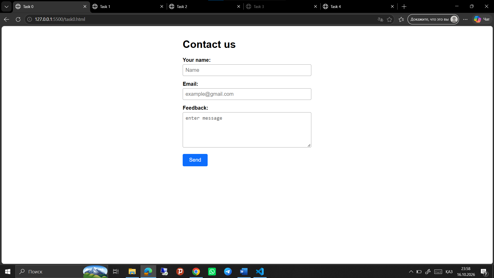
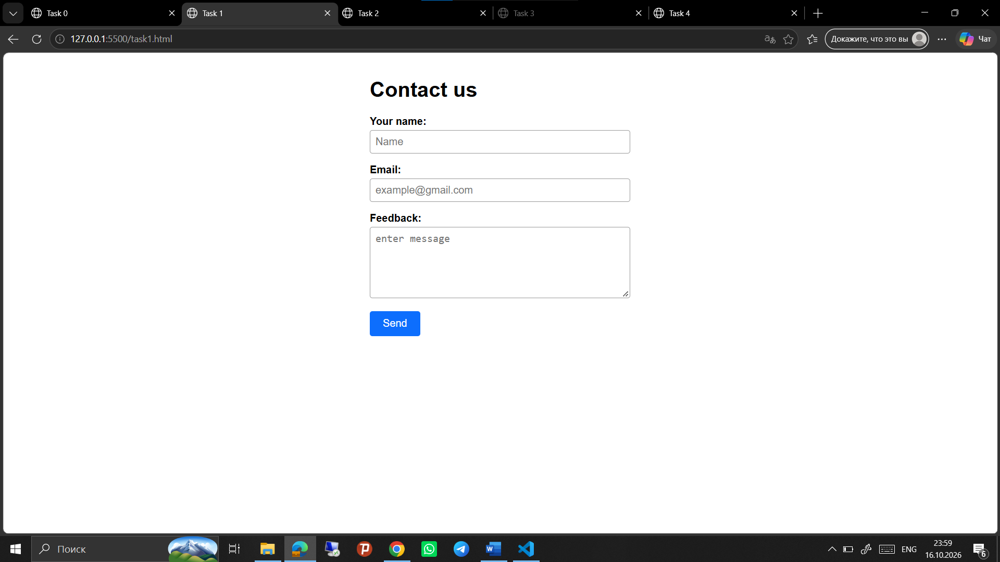
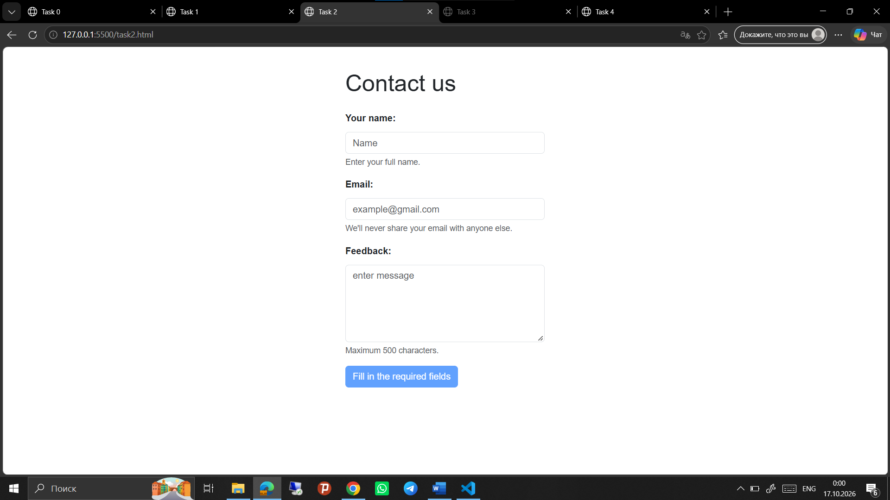
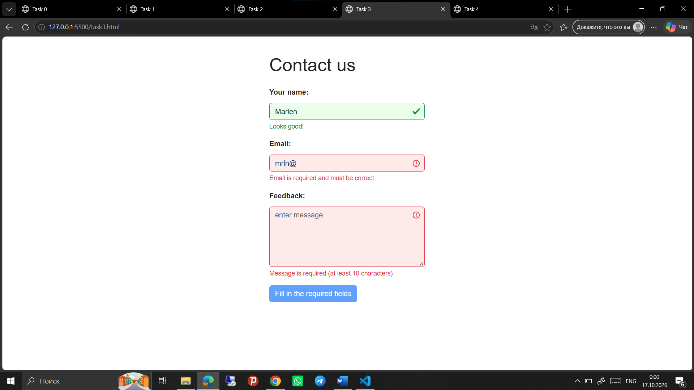
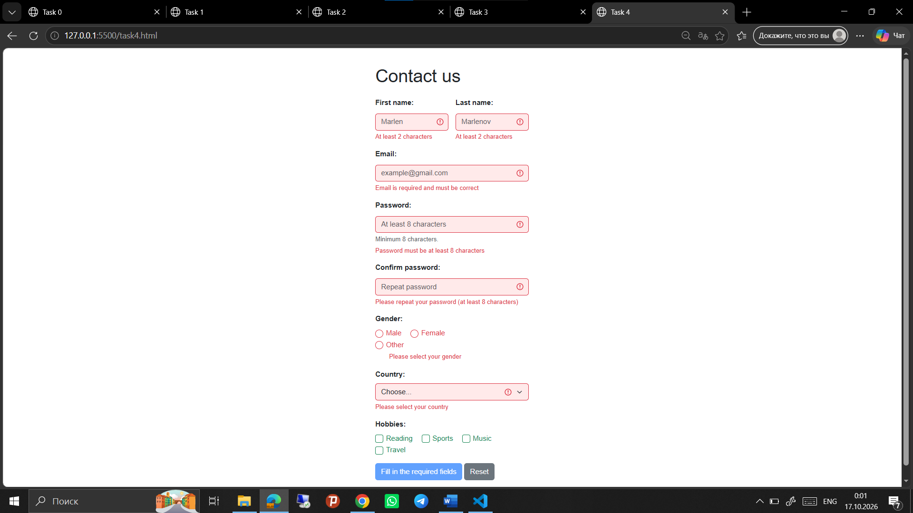

# Assignment 4. Forms and Validation

**Name:** Azimbek Amandykov
**Group:** SE-2539

---

## Part 1. Basic HTML Forms

### Task 0. Simple Contact Form
**Task:** Create a basic contact form with Name (text), Email (email), Message (textarea) and a Submit button. All fields must have proper `<label>` elements.

**What I did:** I made a simple form with three fields and a "Send" button. Each field is connected to its label using `for` and `id`. There is no validation yet.

**Screenshot:**

### Task 1. Form with HTML5 Validation
**Task:** Add built-in validation attributes (`required`, `type`, `maxlength`, etc.) and test how the browser enforces them.

**What I did:** I added `required` to all fields and `minlength`/`maxlength` for the name (2–50) and the message (10–500). The email is checked with `type="email"`. I tested it: if a field is empty or the email has no `@`, the browser blocks the form and shows a hint.

**Screenshot:**

---

## Part 2. Bootstrap Forms

### Task 2. Bootstrap Form Styling
**Task:** Recreate the contact form using Bootstrap classes, arrange fields with the grid, and add placeholders and helper text.

**What I did:** I connected Bootstrap 5 through a CDN and used `form-control`, `form-label`, `row`, `col-12` and `btn btn-primary`. I added helper text under the fields with `form-text`. In `style.css` the button text changes by itself: while the form is incomplete it says "Fill in the required fields", and when everything is valid it says "Submit".

**Screenshot:**

### Task 3. Bootstrap Validation Styles
**Task:** Apply `is-valid` and `is-invalid` classes, show feedback messages below inputs ("Looks good!", "Email is required"), and test with valid and invalid data.

**What I did:** As an example, I filled the form like this: name "Marlen" (`is-valid`, green), email "mrln@" (`is-invalid`, red) and an empty message (`is-invalid`). Every field has `valid-feedback` and `invalid-feedback` messages under it.

**Screenshot:**

---

## Part 3. Advanced Form Project

### Task 4. Registration Form
**Task:** Create a registration form with First Name, Last Name, Email, Password + Confirm Password, Gender (radio), Hobbies (checkboxes), Country (select), and Submit and Reset buttons. Make it responsive with the Bootstrap grid, add HTML5 validation (e.g. minimum password length) and Bootstrap validation feedback.

**What I did:** I added all the required fields. First name and last name are in one row (`col-6`), and the other fields take the full width (`col-12`), so the form looks fine on different screen sizes. The password has `minlength="8"`. I added the `was-validated` class, so Bootstrap shows green and red fields with messages automatically. The form has Submit and Reset buttons.

**Screenshot:**

---

## Summary of my work

I started with a simple HTML form (Task 0) and improved it step by step. First I added the browser's built-in validation (Task 1), then I connected Bootstrap and made the form look better (Task 2). After that I learned how `is-valid` and `is-invalid` work (Task 3). At the end I built a big registration form that uses everything together (Task 4). Common styles are in `style.css`.

To run the project, open any `taskN.html` file in a browser (Tasks 2–4 need internet because Bootstrap is loaded from a CDN).